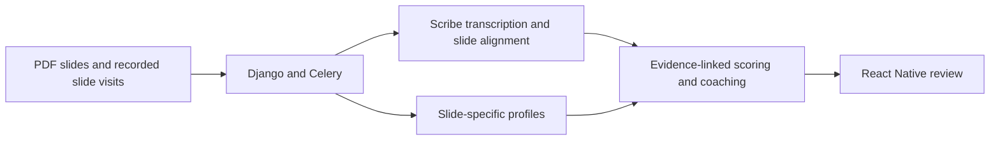

# OutLoud

OutLoud is an Android presentation-practice app built by SNU Software Project Team 07. It combines PDF slides, recorded rehearsals, slide-aligned transcripts, and AI scoring and coaching.

This is Seoyeon Park's portfolio copy of the team's published [v8 source snapshot](https://github.com/snuhcs-course/swpp-2026-project-team-07/tree/cdb8055f0fd5022aafccb47625889d3f9a403f5f), dated November 3, 2026. It contains the app, backend, and tests with fresh Git history.

## My AI-feedback work

I was a lead developer on our four-person team and was responsible for AI-feedback implementation. My work focused on what the model should evaluate, how to make its feedback useful, and how to connect that feedback to the app.

Early coaching often said things like “explain more” or “insufficient evidence” without telling the speaker what to change. I revised the prompts to analyze the slides first and identify concrete points to check in the presentation. For example, a broad question about whether a presentation was specific became a check for whether the speaker mentioned a particular statistic from the slides. I also asked the model to give a concrete next step for each item that needed work.

I compared Korean and English versions of the same script after noticing that similar written reviews could produce different grades. Checking explicit slide-specific items brought the observed scores closer, although differences remained. This was a qualitative development comparison; it does not establish that the evaluator is calibrated across languages. Comparing against human ratings is a next step.

I also worked on integrating transcription, scoring, and coaching with asynchronous Django/Celery processing and the React Native review flow, including retry and recovery states. Development was collaborative and AI-assisted; the existing source attribution comments are retained.

### Relevant implementation

| Part | Code |
| --- | --- |
| Slide analysis and coaching prompts; provider adapters | [feedback_provider.py](backend/rehearsals/services/feedback_provider.py) |
| Feedback schemas and evidence validation | [feedback.py](backend/rehearsals/services/feedback.py) |
| Rubric selections, evidence reconstruction, and score calculation | [presentation_score_v2.py](backend/rehearsals/services/presentation_score_v2.py) |
| Scoring jobs, saved results, and retry handling | [presentation_scoring.py](backend/rehearsals/services/presentation_scoring.py) |
| Slide-level feedback orchestration | [slide_review.py](backend/rehearsals/services/slide_review.py) |
| Mobile feature integration | [mobile/src/features](mobile/src/features) |

These links show the relevant team implementation. The evaluator checks evidence references and uses fixed arithmetic to turn model-selected rubric levels into scores. Those checks do not establish that the model's interpretation is correct.

## How it fits together



The client uses Expo, React Native, and TypeScript. The backend uses Django, Celery, PostgreSQL, and Redis. Transcription uses ElevenLabs Scribe; feedback providers are configured on the backend. Provider credentials stay on the server.

## Run locally

Prerequisites: Node.js 24, Docker with Compose, and an Android development environment with JDK 17 and Android SDK 36.

```sh
git clone https://github.com/gabdeguate/OutLoud.git
cd OutLoud
cp -n backend/.env.example backend/.env
docker compose up --build
```

In another terminal:

```sh
cd OutLoud/mobile
npm ci
cp -n .env.example .env
npm run android
```

Use an Android emulator or development build; the app requires native modules and does not run in Expo Go. For the emulator, set `EXPO_PUBLIC_API_URL=http://10.0.2.2:8000/api`. For a USB-connected phone, use `adb reverse tcp:8000 tcp:8000` and `http://127.0.0.1:8000/api`.

The example configuration is for local development. The local API has no production authentication. Add your own backend provider keys to enable transcription and configure feedback; provider requests can incur charges. Never put keys in `EXPO_PUBLIC_*` variables or commit local `.env` files.

## Checks

```sh
# From mobile/
npm run check
npm run bundle:android

# From the root, with Compose running
docker compose exec api python manage.py check
docker compose exec api python manage.py test --noinput
docker compose exec api python manage.py makemigrations --check --dry-run

# With Gitleaks installed, from the root
gitleaks dir . --redact
gitleaks git . --redact
```

The app and tests are retained from the tagged snapshot. This portfolio publication is not a new app release or a fresh device/provider test. Full development records and technical documentation remain in the [upstream project](https://github.com/snuhcs-course/swpp-2026-project-team-07).

## Team credits and source

OutLoud was developed by SNU Software Project Team 07:

- [Seoyeon Park / @gabdeguate](https://github.com/gabdeguate) — AI-feedback lead and integration work described above.
- [@BonjourInjoon](https://github.com/BonjourInjoon)
- [@justaoj](https://github.com/justaoj)
- [@zoo-zer0](https://github.com/zoo-zer0)

The original repository's initial course scaffold is credited to [Jinmyeong Kim / @jinbrighten](https://github.com/jinbrighten). Team members share credit for the application; this portfolio copy preserves existing attribution and third-party notices, including the [Expo template license](mobile/LICENSE). It does not add a new license for the team's work.

Source revision: `cdb8055f0fd5022aafccb47625889d3f9a403f5f` (`outloud-demo-v8-20261103`). Deployment files, historical prompt logs, generated reports, and course submission artifacts are omitted. The bundled slide PDF is a demo asset; personal recordings and live provider results are not included.
